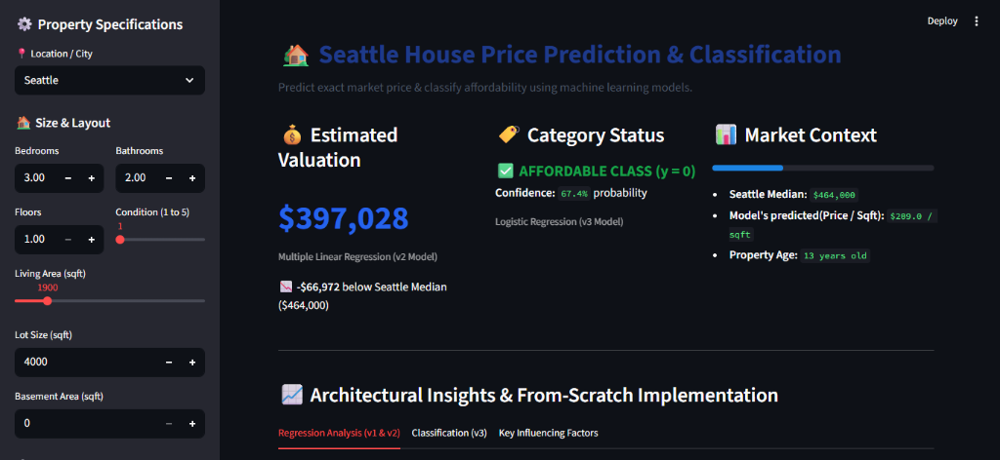
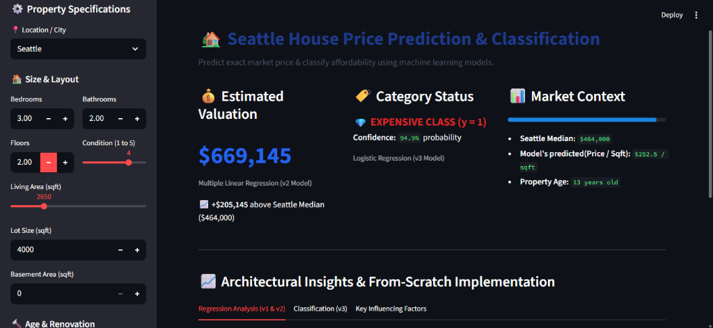

# 🏡 Seattle House Price Prediction & Classification (v1, v2 & v3)

An end-to-end Machine Learning journey implementing multiple regression and classification algorithms completely from scratch using pure NumPy (cost functions, analytical gradients, vectorized gradient descent, eigenvalue stability analysis, and L2 regularization) and thoroughly benchmarked against Scikit-Learn.

---

## 📌 Executive Summary & Architecture

| Stage | Paradigm | Core Objective | Key Features | Model Metric | vs. Baseline |
|---|---|---|---|---|---|
| **v1 Baseline** | Regression | Predict dollar price via `log(price)` | 8 core numeric features, loop-based GD | **Test RMSE: 0.3940**, R²: 0.4909 | Baseline RMSE: 0.5522 (+28.7% better) |
| **v2 Advanced** | Regression | Feature engineering & 1000× speedup | 55 features (+age, +renovated, +44 cities) | **Test RMSE: 0.2721**, R²: **0.7217** | Baseline RMSE: 0.5158 (+47.2% better) |
| **v3 Logistic** | Binary Classification | Classify: Expensive (1) vs. Affordable (0) | 55 features, Sigmoid, Log Loss, L2 Regularization | **Test Accuracy: 85.32%** | Dumb Baseline: 49.34% (**+36% gain**) |

---

## 🖥️ Interactive Web Application (Live Demo)

An interactive Streamlit web dashboard (`app.py`) allowing users to adjust property specifications in real-time across 55 features and simultaneously receive:
1. **Continuous Price Valuation ($):** Predicted by the Vectorized Linear Regression model ($R^2 = 0.7217$).
2. **Binary Affordability Classification:** Predicted by the Logistic Regression classifier ($85.32\%$ test accuracy) with probability confidence scoring.

### 1. Affordable Class Prediction (`$397,028` Valuation, $y=0$):


### 2. Expensive Class Prediction (`$669,145` Valuation, $y=1$):


---

## 📊 Stage 1: Linear Regression Baseline (v1)

- **Notebook:** `House_price_prediction_by_linear_reg(v1).ipynb`
- **Data:** 4,549 cleaned listings after dropping 49 zero-price listings and 2 zero-bedroom/bathroom entries.
- **Features (8):** `bedrooms`, `bathrooms`, `sqft_living`, `sqft_lot`, `floors`, `waterfront`, `view`, `condition`.
- **Target:** `log(price)` to stabilize the right-skewed pricing distribution.
- **Implementation:** Loop-based Gradient Descent ($\alpha = 0.05$, 2,000 iterations).
- **Results:**
  - Cost reduced from 85.47 to 0.0734.
  - Test RMSE: **0.3940**, R²: **0.4909**.
  - Verified exact match with Scikit-Learn `LinearRegression` (`np.allclose = True`).
- **Learning Rate Limit:** Theoretical convergence limit $\alpha < 2/\lambda_{\max} \approx 0.759$ experimentally verified ($\alpha = 0.7$ converged, $\alpha = 0.8$ diverged).

---

## 🚀 Stage 2: Advanced Pipeline & Ablation Study (v2)

- **Notebook:** `Advanced_linear_reg(v2).ipynb`
- **Outlier Trimming:** Filtered listings above the 99.5th percentile of `price_per_sqft` (~$675.13 / sqft), trimming 23 extreme listings (4,549 -> 4,526 rows).
- **Feature Engineering:**
  - Verified exact collinearity: `sqft_living = sqft_above + sqft_basement`, dropping `sqft_above`.
  - Derived binary `renovated = (yr_renovated > 0)` and `age = 2014 - yr_built`.
  - One-hot encoded 44 cities, expanding feature space to **55 features**.
- **Vectorized Gradient Descent:** Replaced Python loops with NumPy BLAS matrix operations ($X^T \cdot \text{error}$), achieving a **1000× speedup** (~0.07 ms per step vs. ~60 ms loop-based).
- **Ablation Study Results:**
  | Model | Feature Set | Test RMSE | R² Score | Key Finding |
  |---|---|---|---|---|
  | **Model A** | 8 original features | 0.3659 | 0.4965 | Trimming outliers alone improved RMSE from 0.3940 -> 0.3659 |
  | **Model B** | 11 features (+basement, renovated, age) | 0.3547 | 0.5270 | Engineered features added clean non-linear signals (+3.1% R²) |
  | **Model C** | 55 features (+44 city one-hot columns) | **0.2721** | **0.7217** | Geographical location provided massive predictive power (+19.5% R²) |
- **Eigenvalue Limit Shift:** With 55 features, the theoretical stability boundary shifted to $2/\lambda_{\max} \approx 0.602$. Confirmed: $\alpha = 0.5$ converged rapidly, while $\alpha = 0.7$ diverged into numerical overflow.
- **Error Analysis:** Diagnosed top-10 worst test predictions; identified that linear regression's additive nature over-predicted large-lot, low-cost listings (e.g., an $84,350 house in Yarrow Point predicted at $1.68M due to real-estate label noise/distressed sale).

---

## 🎯 Stage 3: Logistic Regression & L2 Regularization (v3)

- **Notebook:** `House_price_pred_by_logis_reg.ipynb`
- **Problem Formulation:** Partitioned houses by the median price ($464,000) to create a balanced binary target:
  - **Class 1 (Expensive):** Price $\ge$ $464,000 (2,266 houses, 50.07%)
  - **Class 0 (Affordable):** Price < $464,000 (2,260 houses, 49.93%)
- **From-Scratch Math:**
  - Sigmoid Activation:
    $$g(z) = \frac{1}{1 + e^{-z}}$$
  - Binary Cross-Entropy (Log Loss) with L2 regularization and numerical clipping ($10^{-15} \le f \le 1 - 10^{-15}$):
    $$J(w, b) = -\frac{1}{m} \sum_{i=1}^m \Big[ y^{(i)} \log(f^{(i)}) + (1 - y^{(i)}) \log(1 - f^{(i)}) \Big] + \frac{\lambda}{2m} \sum_{j=1}^n w_j^2$$
  - Vectorized Gradient:
    $$\frac{\partial J}{\partial w} = \frac{1}{m} X^T(f - y) + \frac{\lambda}{m}w, \quad \frac{\partial J}{\partial b} = \frac{1}{m} \sum (f - y)$$
- **Classification Performance:**
  - **Dumb Majority Baseline Accuracy:** 49.34%
  - **Scratch Logistic Regression Accuracy:** **85.32%** (beating Scikit-Learn default 85.10%)
  - **Confusion Matrix (906 Test Samples):**

    | | Predicted Affordable ($y=0$) | Predicted Expensive ($y=1$) | Class Recall |
    |---|:---:|:---:|:---:|
    | **Actual Affordable** | **392** (True Negative) | 67 (False Positive) | **85.4%** |
    | **Actual Expensive** | 66 (False Negative) | **381** (True Positive) | **85.2%** |
- **L2 Regularization Experiments:**
  - $\lambda = 0$: Test Acc = 85.32%, $\|w\|_2 = 6.45$
  - $\lambda = 1$: Test Acc = 85.32%, $\|w\|_2 = 1.87$ (controlled shrinkage)
  - $\lambda = 100$: Test Acc = 83.77%, $\|w\|_2 = 1.25$ (**Underfitting verified**)
  - Tested small-sample regime ($m=50 < n=55$) to demonstrate how regularization restricts weight explosion in data-scarce conditions.

---

## 🛠️ Project Structure

```
House_price_prediction/
├── assets/
│   ├── demo_affordable.png                          # Streamlit UI: Affordable class prediction
│   └── demo_expensive.png                           # Streamlit UI: Expensive class prediction
├── House_price_prediction_by_linear_reg(v1).ipynb   # v1 Baseline linear regression (8 features, loops)
├── Advanced_linear_reg(v2).ipynb                    # v2 Advanced linear regression (55 features, vectorized)
├── House_price_pred_by_logis_reg.ipynb              # v3 Logistic regression classification (Sigmoid, L2)
├── app.py                                           # Streamlit interactive deployment application
├── model_assets.json                                # Pre-trained weights, scaling parameters & metadata
├── requirements.txt                                 # Python dependencies
└── README.md                                        # Complete engineering documentation
```

---

## 📦 Dependencies & Environment

This project is built with Python 3.9+ (tested on Python 3.12.7). All required packages are listed in `requirements.txt`:

| Library | Min Version | Role in the Project |
|---|---|---|
| **`numpy`** | `>=1.24.0` | Mathematical engine: vectorized matrix operations, gradient descent loops, sigmoid activation, log loss, and Hessian eigenvalue limit calculation |
| **`pandas`** | `>=2.0.0` | Data processing: dataset ingestion, filtering missing/zero entries, 99.5th percentile outlier trimming, and one-hot encoding |
| **`matplotlib`** | `>=3.7.0` | Plotting: cost vs. iterations learning curves, regression scatter plots, ablation study performance comparisons, and weight shrinkage visualizations |
| **`scikit-learn`** | `>=1.2.0` | Benchmarking: train/test splitting (`random_state=42`) and ground-truth parity validation for from-scratch algorithms |
| **`streamlit`** | `>=1.28.0` | Interactive web dashboard: live sliders and inputs for 55 features with real-time price estimation and affordability probability classification |

---

## 💻 Step-by-Step Setup & How to Run

Follow these instructions to set up and run the project on your local machine:

### 1. Clone the Repository
```bash
git clone https://github.com/ksh-50/House_price_prediction.git
cd House_price_prediction
```

### 2. (Optional) Create & Activate a Virtual Environment
- **On Windows (PowerShell):**
  ```powershell
  python -m venv venv
  .\venv\Scripts\Activate.ps1
  ```
- **On macOS / Linux:**
  ```bash
  python3 -m venv venv
  source venv/bin/activate
  ```

### 3. Install Required Dependencies
Install all required libraries using `requirements.txt`:
```bash
pip install -r requirements.txt
```

### 4. Run the Jupyter Notebooks
To inspect the step-by-step mathematical proofs, experiments, and visualizations:
```bash
jupyter lab
# or
jupyter notebook
```
From the Jupyter interface, you can explore:
1. `House_price_prediction_by_linear_reg(v1).ipynb` — Baseline 8-feature Linear Regression from scratch with loop-based Gradient Descent.
2. `Advanced_linear_reg(v2).ipynb` — Advanced regression with outlier removal, 55 engineered features, 1000× vectorized speedup, 3-stage ablation study, and the $\alpha < 2/\lambda_{\max}$ eigenvalue stability limit proof.
3. `House_price_pred_by_logis_reg.ipynb` — Binary affordability classification from scratch using Sigmoid, Log Loss, and $L_2$ regularization experiments.

### 5. Launch the Streamlit Interactive Web App
To run the live interactive dashboard:
```bash
streamlit run app.py
```
*(If `streamlit` command is not on your PATH, run: `python -m streamlit run app.py`)*

Once started, the app will automatically open in your web browser at:
```
http://localhost:8501
```

---

## 📂 Dataset Attribution

The models in this repository are trained and evaluated on the **King County / Seattle Housing Data** from Kaggle:
- **Kaggle Dataset Link:** [House Data - King County, USA (Kaggle)](https://www.kaggle.com/datasets/shree1992/housedata/data)
- **Description:** Historical residential property sales recorded in King County, Washington (Seattle, Bellevue, Redmond, Kirkland, etc.). Features include bedrooms, bathrooms, living area square footage, lot size, floors, waterfront presence, view rating, condition, year built, renovation year, and city location.
